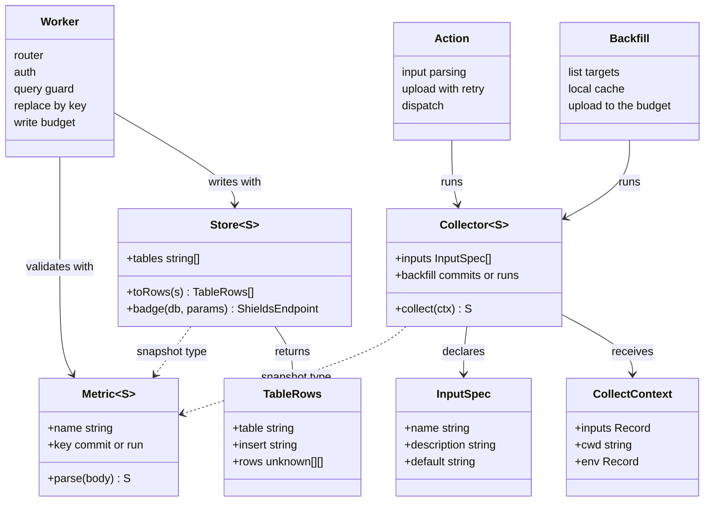
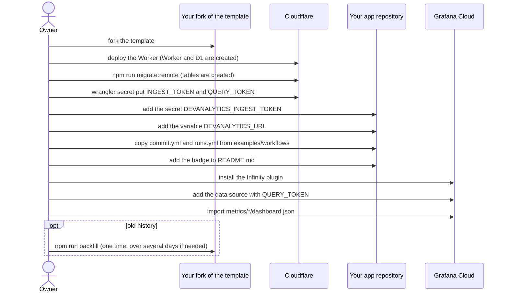
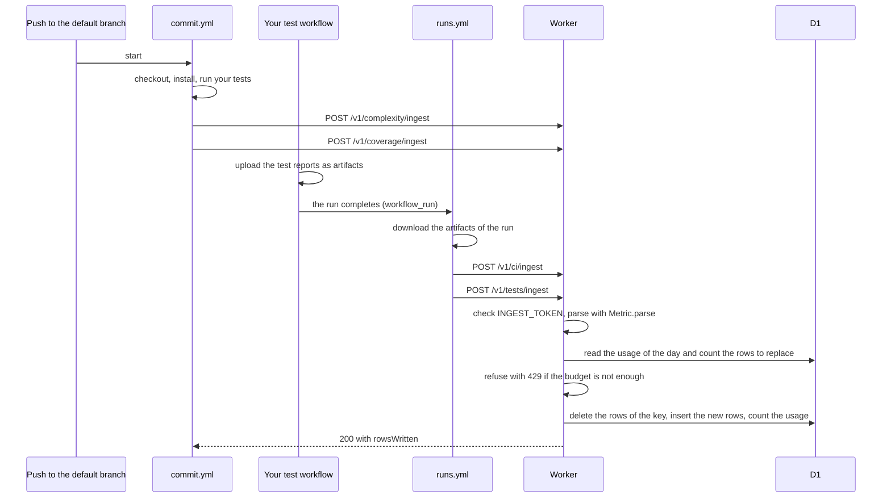
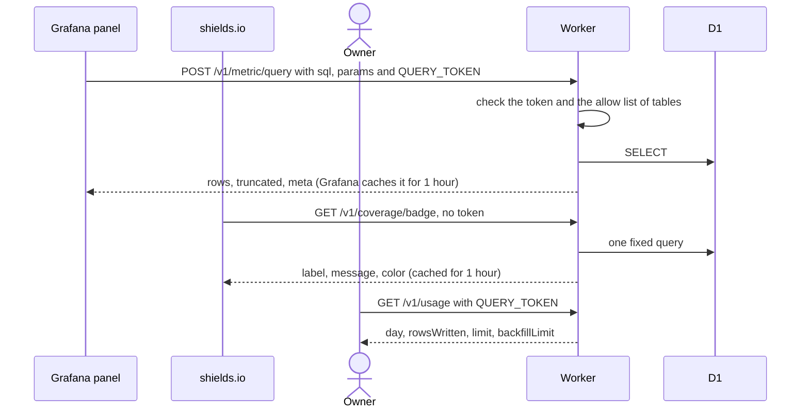
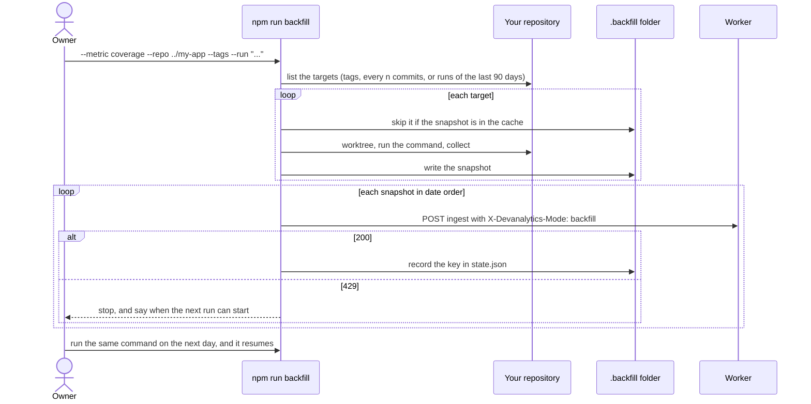

# Architecture

Devanalytics has a small core and a set of metrics. A metric is one folder in `metrics/`. The core gives each metric a Worker route, an Action input and a backfill command. The metric gives the core its data model.

This page shows the contract between the core and a metric, the four flows of the product, and the steps to add, change and remove a metric.

## The metric contract

A metric has three parts. Each part is a file in `metrics/<name>/`.

- `metric.ts` holds the snapshot type and the validation. The Worker and the Action both import it. It does no I/O.
- `store.ts` runs in the Worker. It turns a snapshot into table rows.
- `collect.ts` runs in the Action and in the backfill command. It reads the repository and makes a snapshot.



### What the core enforces

- **Key columns.** Each table of a `commit` metric has `sha` and `date`. Each table of a `run` metric has `run_id`, `run_attempt` and `date`. The core deletes and inserts rows by these columns, so `toRows` never deletes.
- **Dates.** `date` is the commit date or the run start time. It is never the upload time. A backfill then gives correct trends.
- **Table names.** Each table name starts with `<name>_`. The query route of a metric accepts only its own tables.
- **Write budget.** An ingest that would pass the daily row limit gets a `429`.

### What `npm run sync` does

`npm run sync` reads `metrics/*/` and writes three things:

- `src/generated/worker-registry.ts`. It imports `metric.ts` and `store.ts` of each metric.
- `action/src/generated/collector-registry.ts`. It imports `metric.ts` and `collect.ts` of each metric.
- `migrations/`. It holds the core migrations and a copy of each metric migration, named `<name>__<file>`. Wrangler applies the files in name order and records each name.

The generated files are in git. CI fails when `npm run sync` changes them.

## The four flows

### 1. Setup

You do this once.



### 2. Every day

The workflows in your repository send the data. The Worker never reads your code. It only receives JSON snapshots.



- A `commit` metric runs on a push to the default branch. A second push of the same sha replaces its rows.
- A `run` metric runs after each run of the workflows that you list in `runs.yml`, on any branch. A re-run attempt is a new key.
- An upload that fails fails only its own workflow. It never fails your tests or your releases.

### 3. Reading



### 4. Backfill

You do this once, on your machine, from your fork of the template.



## Add a metric

1. Make the folder `metrics/<name>/`. The name uses lowercase letters and digits only. It is also the URL segment and the table prefix.
2. Write `metric.ts`, `store.ts` and `collect.ts` as in the contract above.
3. Write `migrations/0001_init.sql`. Each table starts with `<name>_` and has the key columns of the metric.
4. Add `fixtures/snapshot.json`, the tests, `README.md` and, if you want a view, `dashboard.json`.
5. Run `npm run sync`. It updates the registries and `migrations/`.
6. Run `npm run build:action`, `npm run typecheck`, `npm run lint` and `npm test`. Then run `npm run smoke -- <name>`.
7. Commit the folder and the generated files.
8. Apply the change to your deployment: `npm run migrate:remote`, then `npm run deploy`.

`docs/write-a-metric.md` shows these steps on an example.

## Change a metric

- **A change to the validation or the collector.** Edit the files and run the checks. Old rows stay as they are.
- **A change to the tables.** Never edit a migration that is applied. Add a new file, such as `0002_add_column.sql`, in `metrics/<name>/migrations/`. Run `npm run sync`, `npm run migrate:remote` and `npm run deploy`, in this order.
- **A change to a dashboard.** Edit `dashboard.json` and import it again. The `uid` of the dashboard stays the same, so Grafana replaces the old version.

## Remove a metric

1. Delete the folder `metrics/<name>/`.
2. Run `npm run sync` and `npm run build:action`. The registries and `migrations/` lose the metric.
3. Run `npm run deploy`. The routes of the metric are gone.
4. Remove the workflow step in your repository.

The tables and the rows stay in D1. To free the space, drop the tables of the metric:

```
npx wrangler d1 execute DB --remote --command "DROP TABLE <name>_<table>"
```

Do this only if you never add the metric again. Wrangler records each migration as applied, so it does not create the tables a second time.
